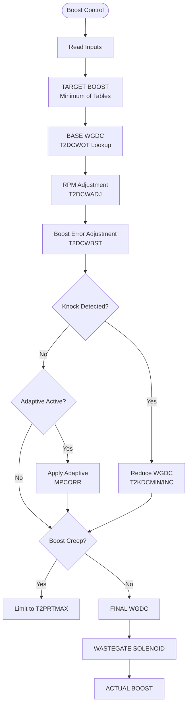
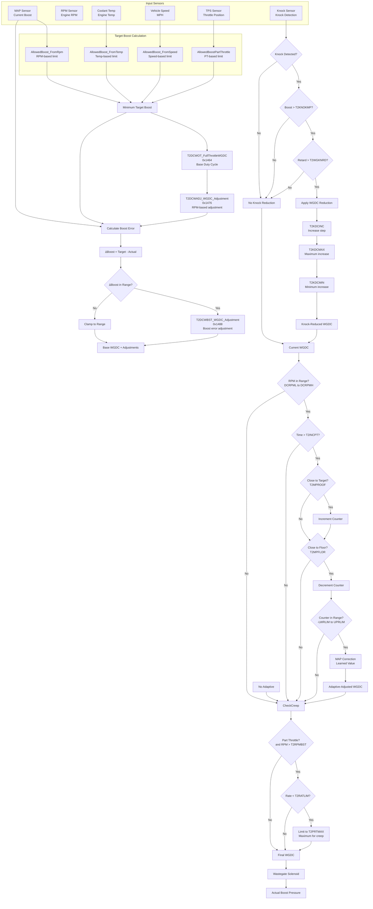
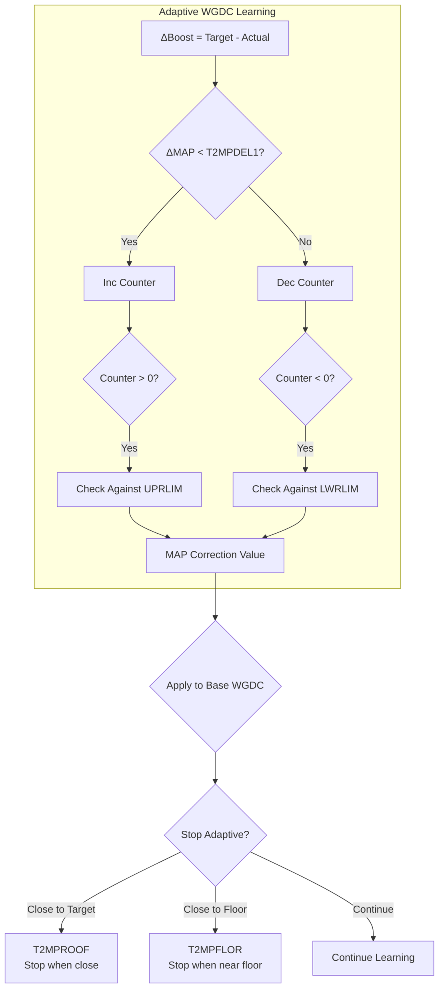
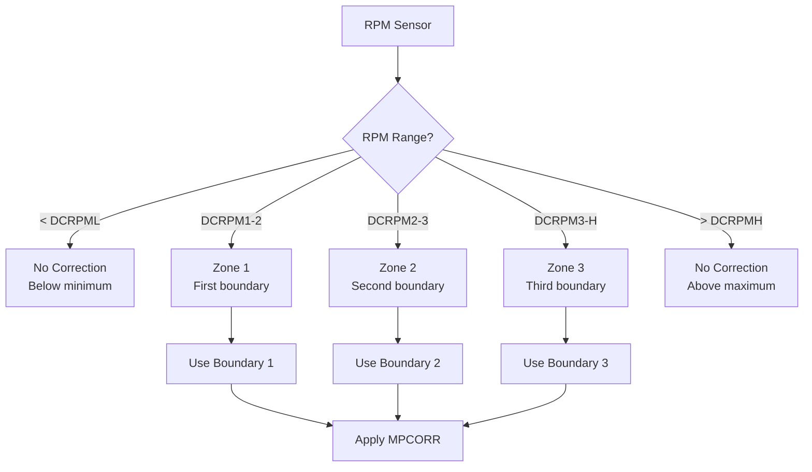
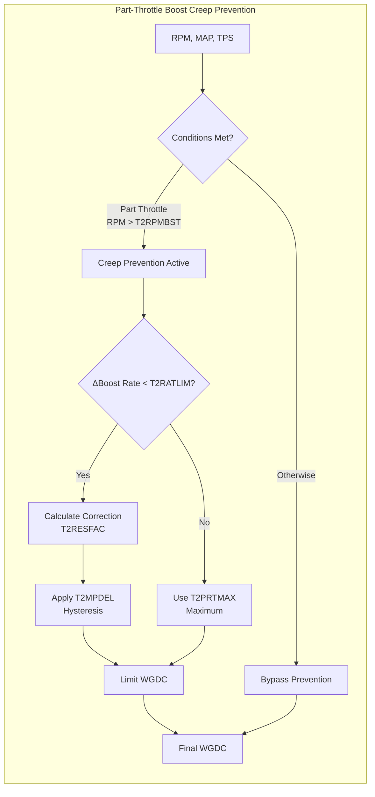
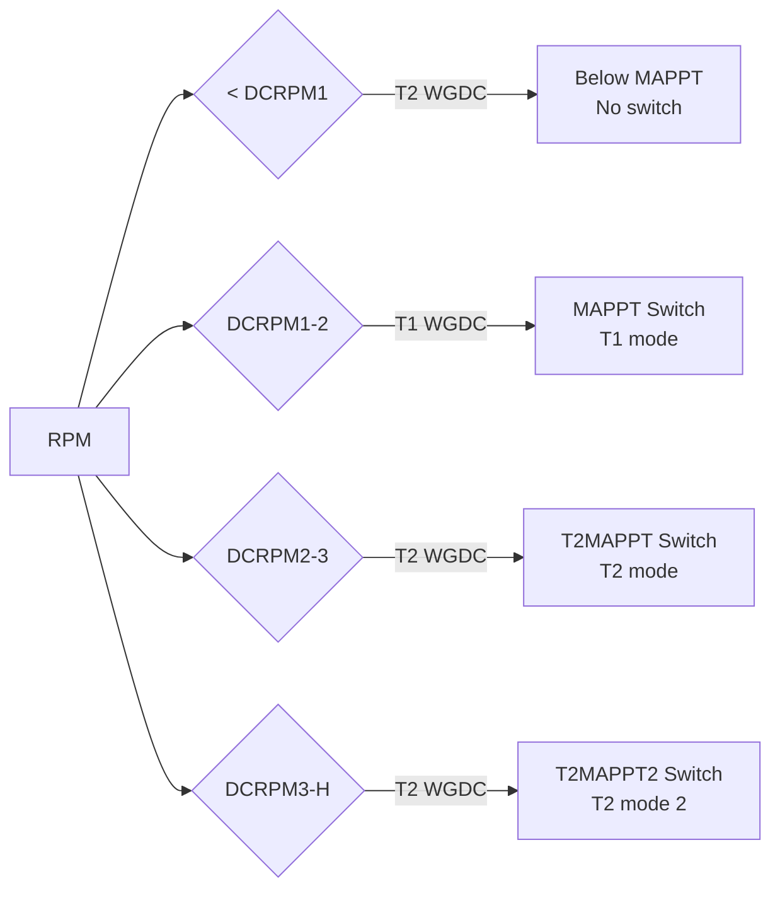

# Boost System Flow

Complete boost control flow for T-SMEC 22 MTX S-II (Turbo II) calibration.

---

## Overview

The boost control system uses wastegate duty cycle (WGDC) to control boost pressure. The system has multiple layers:
1. **Base lookup** - Target boost vs RPM/temperature/speed
2. **WGDC calculation** - Convert target boost to wastegate duty cycle
3. **Adaptive learning** - Adjusts WGDC based on actual vs target boost
4. **Knock interaction** - Reduces WGDC when knock detected
5. **Boost creep prevention** - Limits part-throttle boost buildup

---

## High-Level Flow Diagram



---

## Detailed Boost Control Flow



---

## Adaptive Learning System



**Adaptive Parameters**:
- `T2MPDEL1` (0x14D7) - Increment threshold
- `T2INCPT` (0x14E4) - Time before increment
- `UPRLIM` (0x14F0) - Upper limit
- `LWRLIM` (0x14FC) - Lower limit
- `T2MPROOF` (0x1508) - Stop when close to target
- `T2MPFLOR` (0x1515) - Stop when close to floor

---

## RPM Boundaries for Adaptive



**RPM Boundaries**:
- `DCRPML` (0x13A0) - No correction below
- `DCRPM1` (0x13C8) - Boundary 1
- `DCRPM2` (0x13D5) - Boundary 2
- `DCRPM3` (0x13E2) - Boundary 3
- `DCRPMH` (0x1522) - No correction above

---

## Knock-Boost Interaction

```mermaid
flowchart TD
    subgraph Knock_Interaction["Knock Retard ↔ WGDC Interaction"]
        Knock[Knock Detected] --> BoostLevel{Boost Level?}

        BoostLevel -->|< T2KNOKMP| NoCount[Don't Count Knock]
        BoostLevel -->|>= T2KNOKMP| CountKnock[Count Knock Event]

        CountKnock --> RetardLevel{Retard Amount?}
        RetardLevel -->|>= T2WGKNRD| ReduceWGDC[Reduce WGDC]

        ReduceWGDC --> T2DECTIM[T2DECTIM<br/>Time Scale for Recovery]
        T2DECTIM --> Decay[Decay WGDC Back<br/>T2DCDECK rate]

        NoCount --> NoReduce[No WGDC Reduction]
    end

    subgraph WGDC_Reduction["WGDC Reduction Steps"]
        direction LR

        Base[Base WGDC] --> T2KDCINC["T2KDCINC<br/>Increase Step"]
        T2KDCINC --> Min["T2KDCMIN<br/>Minimum"]
        Min --> Max["T2KDCMAX<br/>Maximum"]
    end

    subgraph Recovery["Recovery When Spark Derated"]
        Derated[Spark Still Derated] --> T2DCDECK["T2DCDECK<br/>Decrement Rate"]
        T2DCDECK --> Normal[Return to Normal]
    end
```



**Knock Parameters**:
- `T2KNOKMP` (0x1408) - Minimum boost to count knock
- `T2WGKNRD` (0x1415) - Minimum retard to reduce WGDC
- `T2KDCINC` (0x149B) - Increase step
- `T2KDCMAX` (0x14A7) - Maximum increase
- `T2KDCMIN` (0x14B3) - Minimum increase
- `T2DECTIM` (0x14BF) - Time scale for recovery
- `T2DCDECK` (0x14CB) - Decrement when still derated

---

## Boost Creep Prevention



**Creep Parameters**:
- `T2RPMBST` (0x1421) - Minimum RPM to track creep
- `T2RATLIM` (0x142D) - Rate limit from RPM
- `T2PRTMAX` (0x143C) - Maximum WGDC for creep
- `T2MPDEL` (0x1448) - Hysteresis
- `T2RESFAC` (0x1455) - Response factor from MAP

---

## MAP Switch Points



**MAP Switch Points**:
- `MAPPT` (0x13BA) - T1 switch point
- `T2MAPPT` (0x13EE) - T2 switch point 1
- `T2MAPPT2` (0x13FB) - T2 switch point 2

---

## Complete WGDC Calculation Formula

```
FINAL_WGDC = T2DCWOT[TargetBoost]              // Base lookup
            + T2DCWADJ[RPM]                      // RPM adjustment
            + T2DCWBST[ΔBoost]                    // Boost error
            - KnockReduction                      // Knock reduction
            + MPCORR                              // Adaptive correction
            (limited by T2PRTMAX if creep)       // Creep limit
```

**Applied to Wastegate** → Actual Boost Pressure

---

## Table Relationships Summary

| Stage | Tables | Effect |
|-------|--------|--------|
| **Target** | AllowedBoost_FromRpm/Temp/Speed/PT | Minimum target boost |
| **Base WGDC** | T2DCWOT, T2DCWADJ, T2DCWBST | Base duty cycle calculation |
| **Knock** | T2KNOKMP, T2WGKNRD, T2KDC* | WGDC reduction when knocking |
| **Adaptive** | T2MPDEL1, T2INCPT, UPRLIM, LWRLIM | Learned MAP correction |
| **Creep** | T2RPMBST, T2RATLIM, T2PRTMAX, T2RESFAC | Part-throttle limit |
| **Boundaries** | DCRPM*, MAPPT*, T2MAPPT* | RPM/MAP zones |

---

## Key Concepts

### Target Boost Selection
The ECU uses the **minimum** of all target boost tables:
- `AllowedBoost_FromRpm` - RPM-based limit
- `AllowedBoost_FromTemp` - Temperature-based limit
- `AllowedBoost_FromSpeed` - Speed-based limit
- `AllowedBoostPartThrottle` - TPS-based limit

### WGDC Meaning
- 0x00 (0) = Wastegate fully closed (maximum boost)
- 0xC8 (200) = 100% duty cycle (wastegate fully open)
- Values above 0xC8 can be used for quick boost reduction

### Adaptive Learning
The system learns a correction value (`MPCORR`) that adjusts the base WGDC:
- Incremented when boost is below target (slowly)
- Decremented when boost is above target (slowly)
- Has upper/lower limits (`UPRLIM`, `LWRLIM`)
- Stops when close to target (`T2MPROOF`) or floor (`T2MPFLOR`)

---

## Related Documents

- [Table Reference](table-reference.md) - Complete table listing
- [Fuel System Flow](fuel-system-flow.md) - Fuel calculation flow
- [Spark System Flow](spark-system-flow.md) - Spark calculation flow
- [Boost Control](../tuning/boost-control.md) - Tuning guide
