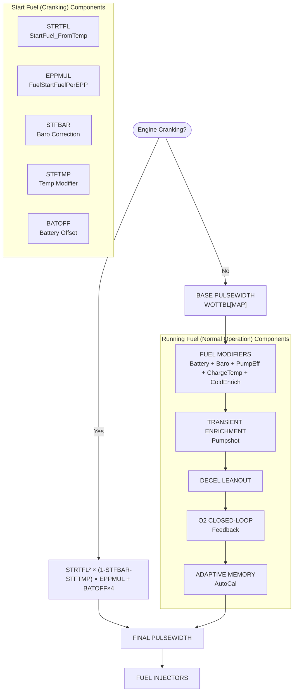
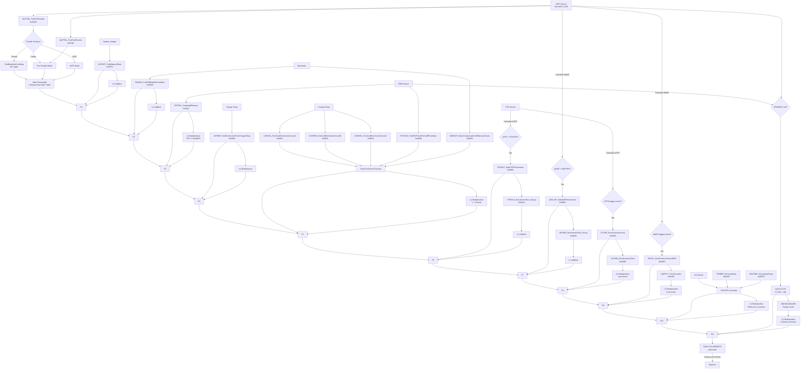
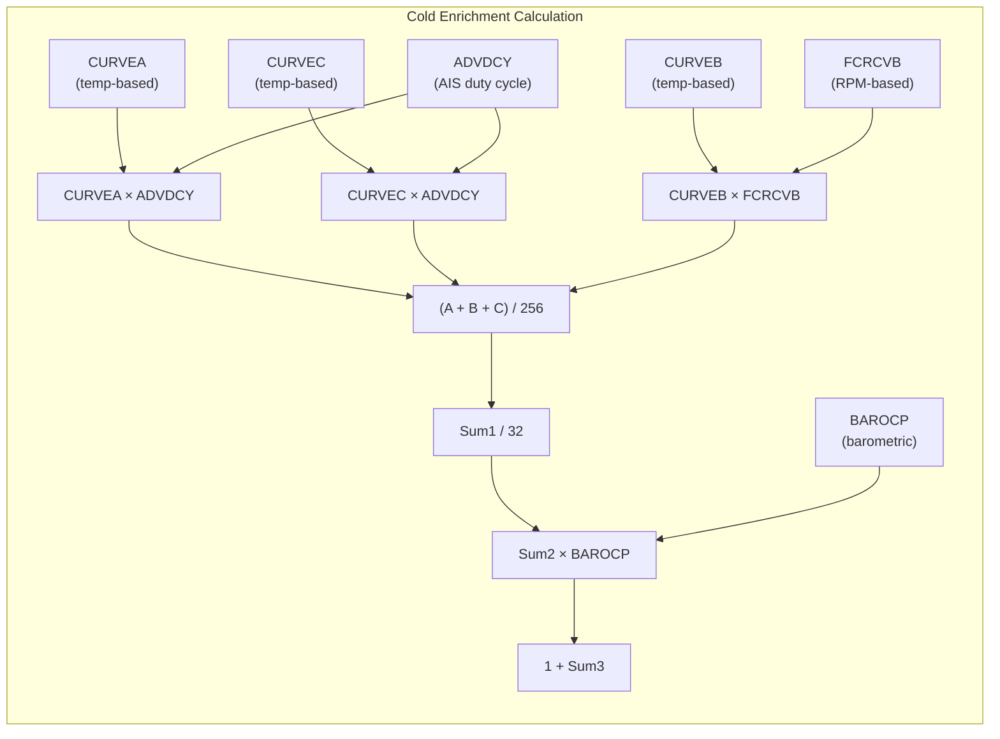
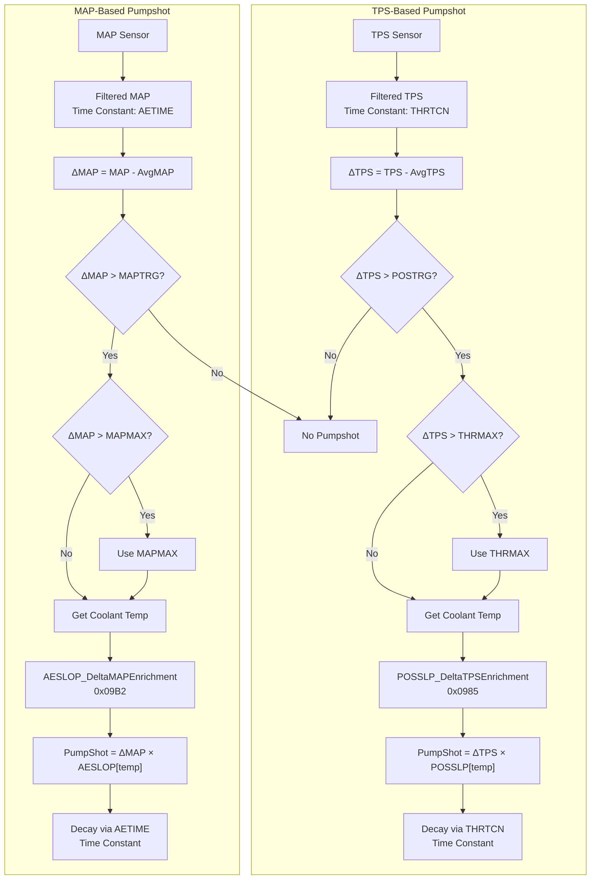
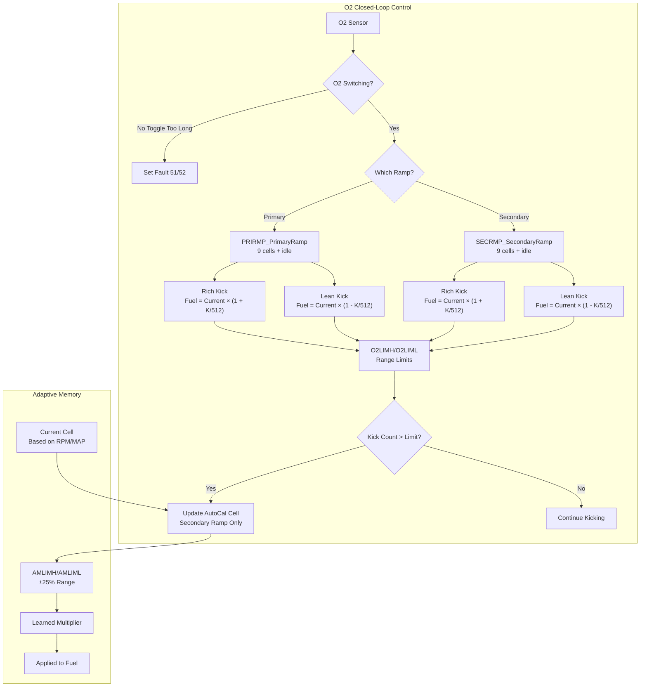

# Fuel System Flow

Complete fuel calculation flow for T-SMEC 22 MTX S-II calibration.

---

## Overview

The fuel system uses a multi-stage calculation that starts with base pulsewidth from lookup tables, then applies numerous modifiers in a specific order. The ECU does not use AFR targets directly - it uses pulsewidth values.

**Key Concept**: The MPTune `;mpfuel*` metadata (mpfuelfull1, mpfuelpart1, etc.) is **only for MPTune visualization**. The ECU uses the actual pulsewidth tables (WOTTBL, MAPTBL, etc.).

---

## High-Level Flow Diagram



---

## Detailed Fuel Calculation Flow



---

## Cold Enrichment Formula Detail



**Formula**: `ColdEnrichmentFactor = 1 + (((CURVEA × ADVDCY + CURVEC × ADVDCY + CURVEB × FCRCVB) / 256) / 32) × BAROCP / 256`

---

## Transient Enrichment (Pumpshot) Flow



---

## O2 Closed-Loop Flow



**AutoCal Cell Layout**:
```
          MAP
    ┌───┬───┬───┬───┬───┬───┐
    │ 1 │ 3 │ 5 │ 7 │ 9 │11 │
R1  ├───┼───┼───┼───┼───┼───┤
    │ 0 │ 2 │ 4 │ 6 │ 8 │10 │
    └───┴───┴───┴───┴───┴───┘
       MP1  MP2  MP3  MP4  MP5

Cell 12 = Idle only (closed throttle)
```

---

## Table Relationships Summary

| Stage | Tables | Effect |
|-------|--------|--------|
| **Base** | WOTTBL, MAPTBL | Primary pulsewidth lookup |
| **Additive** | BATOFF, PWADD | Add fixed µS |
| **Multiplicative** | PEFTBL, AIRTMP | Scale by percentage |
| **Cold Enrich** | CURVEA/B/C, FCRCVB, BAROCP | Temperature/altitude compensation |
| **Pumpshot** | POSSLP, AESLOP, THRTCN, AETIME | Transient enrichment |
| **Decel** | LOTTHR, DECEL, LOTIME, LMAPTC | Leanout during deceleration |
| **O2 Feedback** | PRIRMP, SECRMP, O2CNTR | Closed-loop correction |
| **Adaptive** | AutoCal cells, AMLIMH/L | Long-term learning |

---

## Calculation Order

The ECU applies modifiers in this exact order:

1. **Base pulsewidth** from WOTTBL[MAP]
2. **+ BATOFF[battery]** (additive)
3. **+ PWADD[baro]** (additive)
4. **× PEFTBL[RPM]%** (multiplicative)
5. **× AIRTMP[charge temp]** (multiplicative)
6. **× ColdEnrichment[temp]** (multiplicative)
7. **+ Pumpshot** (additive, if triggered)
8. **× DecelLeanout** (multiplicative, if triggered)
9. **× O2Feedback** (multiplicative, if in closed-loop)
10. **× AutoCal** (multiplicative, if learned)

---

## Related Documents

- [Table Reference](table-reference.md) - Complete table listing
- [Spark System Flow](spark-system-flow.md) - Spark calculation flow
- [Boost System Flow](boost-system-flow.md) - Boost control flow
- [Fuel System](../tuning/fuel-system.md) - Tuning guide
