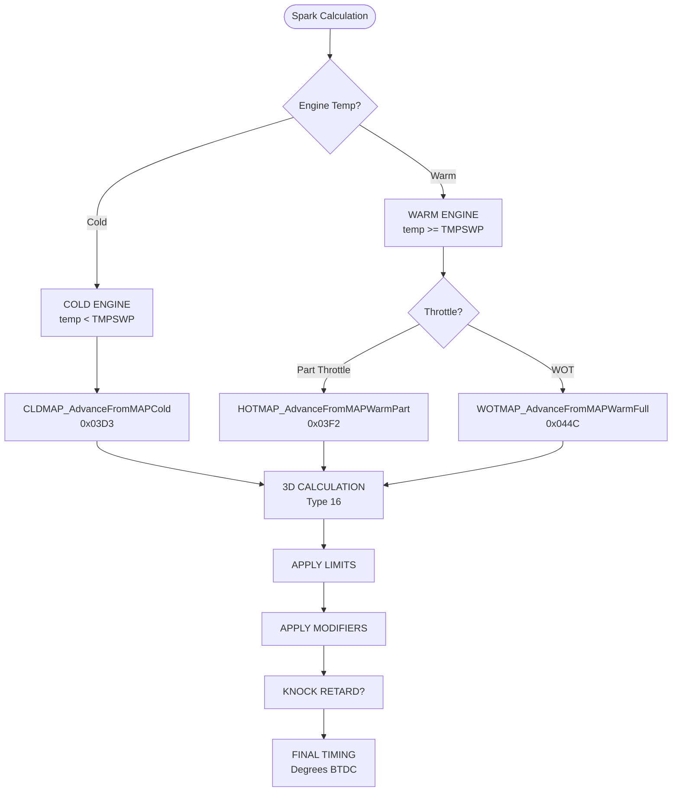
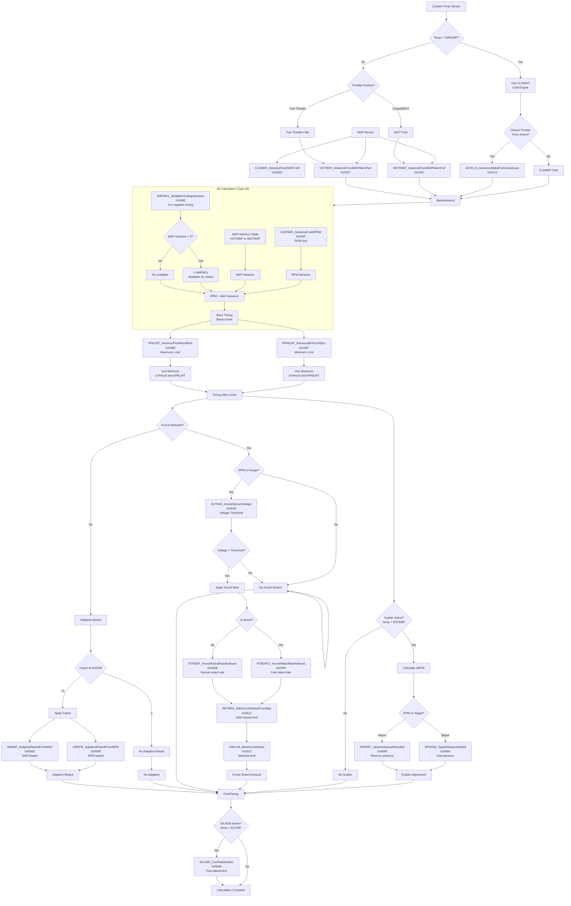
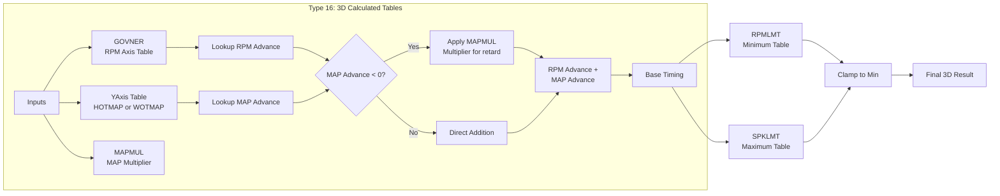
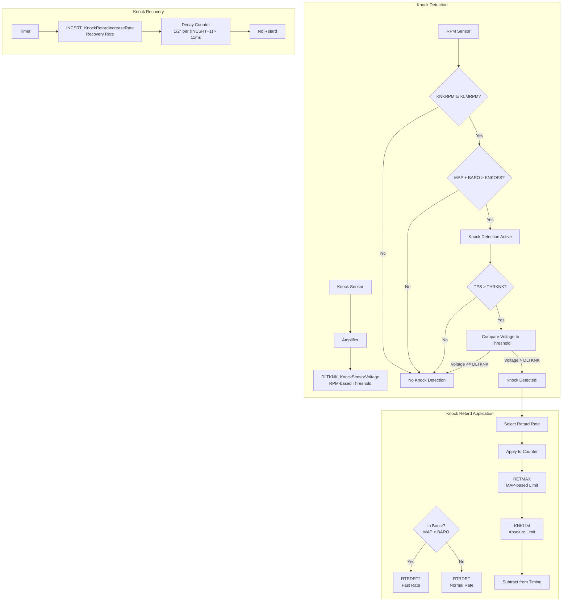
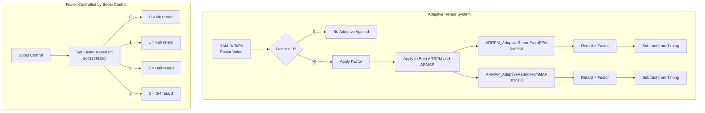
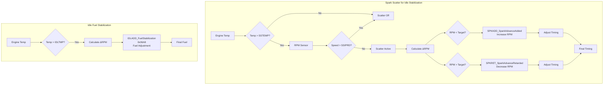
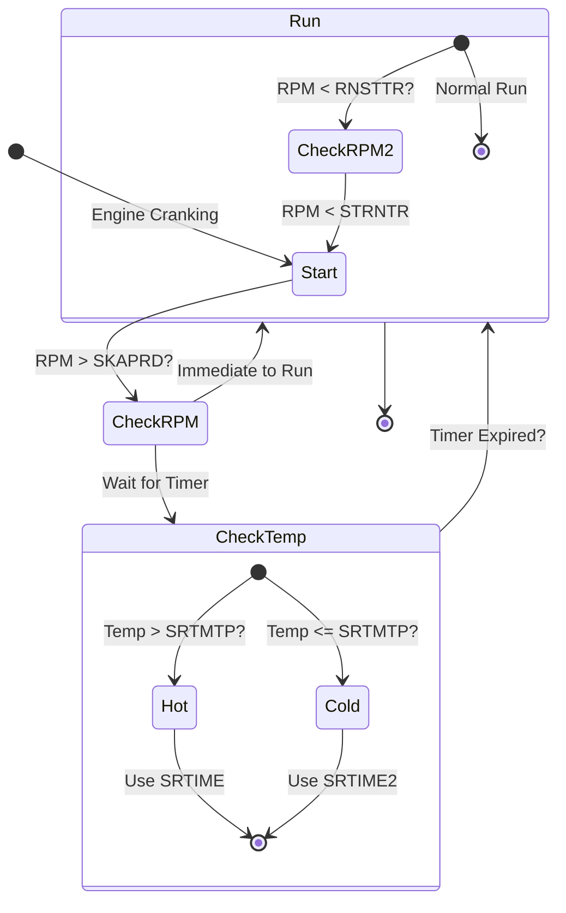

# Spark System Flow

Complete spark/ignition calculation flow for T-SMEC 22 MTX S-II calibration.

---

## Overview

The spark system uses a 3D calculation that combines RPM-based advance with MAP-based advance, then applies limits, knock retard, and adaptive corrections. Unlike fuel, spark is calculated as degrees of advance (not pulsewidth).

**Key Concept**: There is no "base timing" added to calculations. The 12° on emissions stickers is only a synchronization reference - the ECU reports total timing relative to TDC (0°).

---

## High-Level Flow Diagram



---

## Detailed Spark Calculation Flow



---

## 3D Calculation (Type 16) Detail



**Type 16 Tables**:
- `PTTIME_PartThrottleTotalTiming` (0x0421) - Uses HOTMAP
- `FTTIME_FullThrottleTotalTiming` (0x0436) - Uses WOTMAP

---

## Knock Retard Flow



**Knock Retard Rates**:
- `RTRDRT_KnockRetardRateNoBoost` (0x04EB) - Normal rate
- `RTRDRT2_KnockRetardRateInBoost` (0x04F8) - In-boost rate
- `INCSRT_KnockRetardIncreaseRate` (0x0505) - Recovery rate

**Valid INCSRT Values**: 0, 1, 3, 7, 0x0F, 0x1F, 0x3F, 0x7F, 0xFF

---

## Adaptive Retard Flow



**Factor Values** (RAM 0x002B):
- 0 = No adaptive retard
- 1 = Full retard (100%)
- 2 = Half retard (50%)
- 3 = Three-quarter retard (75%)

---

## Spark Scatter Control



**Purpose**: Maintains stable idle RPM by making small timing and fuel adjustments.

---

## Start-to-Run Transfer



**Transfer Points**:
- `STRNTR_SparkStartRunTransferPointRpm` (0x06C6) - Start→Run transfer
- `RNSTTR_SparkRunStartTransferPointRpm` (0x06D3) - Run→Start transfer
- `SKAPRD_SparkImmediateSwitchToRunAboveThisRpm` (0x06E0) - Immediate switch
- `SRTIME/SRTIME2` - Consecutive EPPs above transfer point (hot/cold)
- `SRTMTP_SparkTempSwitchPointFor_SRTIME` (0x0721) - Temp switch

---

## Table Relationships Summary

| Stage | Tables | Effect |
|-------|--------|--------|
| **Base MAP** | CLDMAP, HOTMAP, WOTMAP | MAP-based advance |
| **RPM Axis** | GOVNER | RPM-based advance |
| **Multiplier** | MAPMUL | For negative MAP advance |
| **3D Calc** | PTTIME, FTTIME | Combined RPM+MAP timing |
| **Limits** | RPMLMT, SPKLMT | Min/max clamp |
| **Knock** | RETMAX, KNKLIM, RTRDRT/2 | Knock retard |
| **Adaptive** | ARRPM, ARMAP | Learned retard |
| **Scatter** | SPKADD, SPKRET, IDLADD | Idle stabilization |

---

## Timing Calculation Summary

```
TOTAL TIMING = BaseMAPAdvance + RPMAdvance
              (limited by RPMLMT/SPKLMT)
              - KnockRetard
              - AdaptiveRetard (ARRPM × factor + ARMAP × factor)
              ± ScatterAdjustment
```

**Key Points**:
1. No "base timing" is added - all values are relative to TDC (0°)
2. MAP advance can be negative (retard) under boost
3. `MAPMUL` multiplies negative MAP advance (more retard at higher RPM)
4. Knock retard is recovered slowly using `INCSRT`
5. Adaptive retard is controlled by boost control system

---

## Related Documents

- [Table Reference](table-reference.md) - Complete table listing
- [Fuel System Flow](fuel-system-flow.md) - Fuel calculation flow
- [Boost System Flow](boost-system-flow.md) - Boost control flow
- [Ignition Timing](../tuning/ignition-timing.md) - Tuning guide
