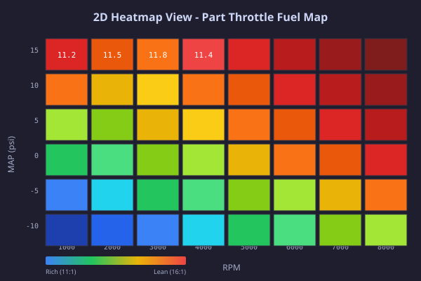
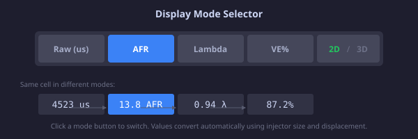
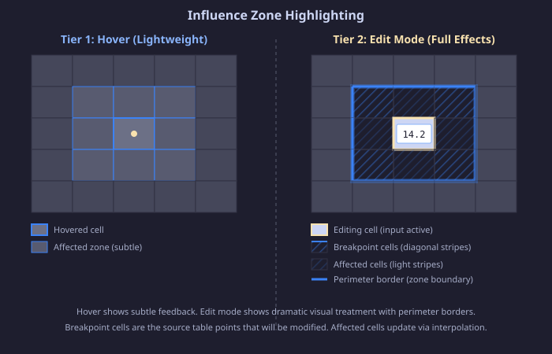
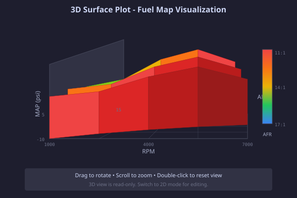
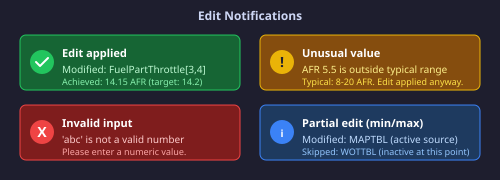

# Computed View Editing Guide

Computed Views are advanced tuning tools that display virtual maps built from multiple source tables combined through mathematical expressions. Instead of editing individual 1D lookup tables separately, you can view and edit their combined effect as a 2D heatmap or 3D surface plot.

## Table of Contents

- [What Are Computed Views?](#what-are-computed-views)
- [Why Use Computed Views?](#why-use-computed-views)
- [Getting Started](#getting-started)
- [Display Modes](#display-modes)
  - [AFR (Air-Fuel Ratio)](#afr-air-fuel-ratio)
  - [Lambda](#lambda)
  - [VE% (Volumetric Efficiency)](#ve-volumetric-efficiency)
- [Editing Cells](#editing-cells)
- [Understanding Influence Zones](#understanding-influence-zones)
- [2D vs 3D Views](#2d-vs-3d-views)
- [Troubleshooting](#troubleshooting)
- [Advanced Topics](#advanced-topics)

---

## What Are Computed Views?

A Computed View combines values from multiple source tables using a mathematical formula. For example:

**Part Throttle Fuel Map** = `min(MAP_TABLE[MAP], WOT_TABLE[MAP]) * PUMPING_EFFICIENCY[RPM] / 100`

This creates a virtual "fuel map" showing how fuel delivery varies by RPM and MAP. When you edit a cell in this computed view, the software automatically distributes your change back to the appropriate source tables.

### Core Concepts

- **Source Tables**: The 1D lookup tables that feed into the computation
- **Expression**: The mathematical formula combining the sources
- **Computed Grid**: The 2D display showing the result of the expression
- **Influence Zone**: The region of source table breakpoints affected by your edit

---

## Why Use Computed Views?

### Traditional Approach

Tuning fuel and spark timing typically requires adjusting multiple tables:

1. Edit base fuel table
2. Edit correction table
3. Check limits table
4. Repeat until satisfied

This is tedious and easy to make mistakes (accidentally making the map worse while trying to fix one axis).

### Computed View Approach

1. See the final result immediately
2. Edit the combined effect directly
3. Changes distribute intelligently to source tables
4. Verify by viewing the result in real-time

### Common Uses

- **Fuel Tuning**: View combined fuel delivery accounting for all corrections
- **Timing Tuning**: See how base timing + corrections combine across the map
- **AFR Targeting**: Work directly with AFR instead of raw fuel values
- **System Analysis**: Understand how multiple tables interact

---

## Getting Started

### Accessing Computed Views

1. Open PentaTune and load a calibration file
2. Navigate to the parameter tree
3. Look for **Computed Views** group
4. Click on the view you want (e.g., "Part Throttle Fuel Map")

### First Look

The view displays as a color-coded grid with:

- **Rows**: Typically MAP (manifold pressure), ranging from negative to positive
- **Columns**: Typically RPM, ranging from idle to max RPM
- **Colors**: Blue (low values) → Green → Yellow → Red (high values)



The sidebar shows:
- **Source Tables**: Which tables contribute to this view
- **Formula**: The mathematical expression being applied
- **Cell Info**: Details about the selected cell

---

## Display Modes

Different display modes transform the underlying computed values to help you understand them in context.



### AFR (Air-Fuel Ratio)

Shows fuel delivery as Air-Fuel Ratio (mass of air divided by mass of fuel).

**Typical values:**
- **12.5 AFR**: Rich mixture (more fuel) - for power/boost
- **14.7 AFR**: Stoichiometric (complete combustion) - for efficiency
- **16 AFR**: Lean mixture (less fuel) - for economy

**How to use:**
- Lower AFR (richer) = more fuel, more power, less efficiency
- Higher AFR (leaner) = less fuel, better efficiency, less power
- Boost areas typically 11-13 AFR
- Cruise typically 14.5-16 AFR

**Pro tip:** If your fuel table is in pulse width (microseconds), the AFR mode converts automatically using your injector size and engine displacement.

### Lambda

Lambda is a normalized version of AFR where 1.0 = stoichiometric (14.7 AFR).

**Typical values:**
- **0.85 Lambda**: Rich (11-13 AFR equivalent)
- **1.0 Lambda**: Stoichiometric (14.7 AFR)
- **1.10 Lambda**: Lean (16 AFR equivalent)

**When to use:**
- Lambda is useful for comparing across different engine configurations
- Standard tuning references (especially OEM and professional tuners) often use Lambda
- More precise when working across multiple engines with different injectors

### VE% (Volumetric Efficiency)

Shows how efficiently the engine fills with fuel based on pumping efficiency and engine load.

**Typical values:**
- **70-80%**: Normal operation
- **85-95%**: Optimized/turbo operation
- **>100%**: Indicates data scaling issues

**When to use:**
- When working with velocity-based fuel systems
- To understand volumetric efficiency corrections
- When comparing fuel delivery across different engine configurations

---

## Editing Cells

### Basic Editing

1. **Select a cell**: Single-click to select
2. **Start editing**: Double-click the cell
3. **Enter new value**: Type the new value (in the current display mode units)
4. **Confirm**: Press Enter or click outside the cell
5. **Cancel**: Press Escape to discard changes

### During Editing

While you're editing, a visual "influence zone" appears showing:

- **Bright blue border**: The four corner breakpoints that will be modified
- **Blue diagonal stripes**: Cells that will be affected by the change
- **Light blue overlay**: Extended affected region (cells with computed values that change)

This helps you understand exactly what source tables will be modified.

### Edit Confirmation

After you confirm an edit:

1. The cell flashes green briefly (confirming success)
2. Related cells show similar color changes as their values update
3. A notification appears showing the approximation quality
4. The grid recomputes to show the new combined values

### Undo/Redo

- **Undo**: Ctrl+Z (Cmd+Z on Mac) or click the undo button
- **Redo**: Ctrl+Y (Cmd+Y on Mac) or click the redo button
- History is limited to 50 edits per view

---

## Understanding Influence Zones

### What Is an Influence Zone?

When you edit a computed view cell, your change is distributed back to the source tables at specific breakpoint indices. The "influence zone" shows which source table breakpoints will be modified.



### Why Does This Matter?

Suppose you have:

- **MAP table breakpoints**: [-15, -10, -5, 0, 5, 10, 15 psi]
- **RPM table breakpoints**: [500, 1000, 2000, 3000, 5000, 7000 rpm]

If you click on the cell at RPM=2500 (between 2000 and 3000), the algorithm determines which RPM breakpoints to modify and weights their changes based on proximity.

### Breakpoint Selection Algorithm

The algorithm uses **inverse distance weighting** to distribute changes:

1. **Exact breakpoint**: Edit applies full change to that single breakpoint
2. **Between breakpoints**: Change splits between two surrounding breakpoints based on distance
   - Closer breakpoint gets more weight
   - Minimum weight threshold (10%) prevents modifying distant breakpoints

### Example

**Scenario:** You edit the cell at RPM=2400, MAP=5 psi

- **Surrounding RPM breakpoints**: 2000 and 3000
- **Distance to 2000**: 400 rpm (33% of gap)
- **Distance to 3000**: 600 rpm (50% of gap)
- **Weighting**: 2000 breakpoint gets ~60% of change, 3000 gets ~40%

---

## 2D vs 3D Views

### 2D Heatmap (Default)

Shows the grid as a traditional color-coded table.

**Pros:**
- Precise value reading
- Easy to compare specific cells
- Fast performance
- Better for editing (full control)

**Cons:**
- Harder to see overall trends
- Can't see smooth interpolation between grid points

**Use when:**
- Fine-tuning specific cells
- Comparing values across the map
- Editing multiple cells in sequence

### 3D Surface Plot

Shows the grid as a 3D surface where height represents the value.



**Pros:**
- Instantly see overall shape and trends
- Visualize smooth interpolation
- Identify anomalies and plateaus
- Understand gradient direction

**Cons:**
- Can't edit in 3D view
- Harder to read exact values
- Performance depends on complexity

**Use when:**
- Checking overall map shape
- Identifying problem areas
- Verifying smooth transitions
- Creating presentations

### Switching Views

Click the **2D/3D toggle** button in the header to switch. For 1D views (single lookup curves), only 2D mode is available.

---

## Troubleshooting



### "Edit Didn't Apply"

**Symptom:** You edited a cell but the value didn't change.

**Causes and solutions:**

1. **Value was already correct**
   - The algorithm found that the source tables couldn't produce your exact target
   - The closest achievable value was already set
   - Try a different value to see if editing works

2. **Source table couldn't be modified**
   - A source table is marked as "static" (not editable)
   - Only editable sources are modified
   - Check the sidebar "Source Tables" list for "static" labels

3. **Invalid input**
   - Error message would have appeared
   - Check that you entered a valid number
   - Some display modes may have validation (e.g., AFR must be 8-20)

### "Edit Was Approximated"

**Symptom:** Notification says "Value adjusted to nearest achievable: target was X"

**Why this happens:**

Computed views combine multiple source tables. Due to interpolation and the discrete breakpoints in each source table, the exact value you requested might not be achievable.

**Example:**
- You request: 14.2 AFR
- Nearest achievable: 14.15 AFR
- Difference: 0.05 AFR (acceptable tolerance)

This is normal and expected. The algorithm gets as close as possible.

**Solutions:**

1. The approximation is usually within 0.5% - acceptable for tuning
2. If approximation is large (>2%):
   - Try a value between grid points
   - Check that source tables have sufficient breakpoints
   - Try adjusting a different cell first

### "Value Out of Bounds"

**Symptom:** Notification warns about unusual values (e.g., "AFR 5.5 is unusual (typical: 8-20)")

**Why this happens:**

The value you entered is outside normal ranges for that parameter. This is a warning, not an error.

**Common causes:**

1. **Decimal point error**: Entered 5.5 instead of 15.5
2. **Unit confusion**: Mixing lambda and AFR
3. **Legitimate extreme tuning**: High-boost or special fuel setups

**What to do:**

1. Review the warning message
2. Correct if it was a mistake
3. Confirm intentionally if it's legitimate
4. The system will still apply the value

### "Some Source Parameters Not Found"

**Symptom:** Grid shows "Unable to compute view. Some source parameters may be missing."

**Causes:**

1. **Corrupted calibration file**: TPL file is incomplete
2. **Old calibration format**: Uses different parameter names
3. **Custom view definition**: References parameters that don't exist

**Solutions:**

1. Try loading a different TPL file
2. Check the view definition for typos in source names
3. Contact support with the TPL file and error details

### Changes Not Saving

**Symptom:** You edited cells but changes disappeared when you saved.

**Causes:**

1. **TPL file format issue**: File couldn't be saved properly
2. **Binary data corruption**: Save process detected invalid values
3. **File permissions**: Can't write to the TPL file location

**Solutions:**

1. Try saving to a different location
2. Use "Save As" to create a new file
3. Check that the TPL file isn't marked read-only
4. Restart PentaTune if errors persist

### Numbers Change Unexpectedly

**Symptom:** After editing, nearby cells changed values too.

**This is expected behavior.** When you edit a computed view:

1. Your change is applied to source table breakpoints
2. The entire computed grid recomputes
3. Cells that use those same breakpoints will change

**Example:** If you edit cell [2500 RPM, 5 psi], cells at [2000-3000 RPM, 5 psi] might also shift slightly because they use the same breakpoints you modified.

**To minimize this:**
- Edit near grid center (avoids influence zone edge effects)
- Edit one value at a time
- Use small incremental changes rather than large jumps

---

## Advanced Topics

### How Edits Are Distributed (For Advanced Tuners)

When you edit a computed view cell, PentaTune:

1. **Parses the expression** to identify which source tables use which axis
   - Example: `MAPTBL[y]` uses Y-axis (MAP)
   - Example: `PEFTBL[x]` uses X-axis (RPM)

2. **Calculates the change factor**
   - Change factor = new value ÷ old value
   - Square root split: `√(change factor) - 1`

3. **Finds surrounding breakpoints** for each source table
   - Uses inverse distance weighting
   - Closer breakpoints get more weight
   - Maintains smooth transitions

4. **Applies weighted changes** to each source
   - Lower breakpoint: `old_value × (1 + delta × weight_lower)`
   - Upper breakpoint: `old_value × (1 + delta × weight_upper)`

5. **Validates bounds**
   - Ensures values stay within valid ranges (0-65535 for 16-bit)
   - Skips breakpoints that would produce out-of-range values

### Square Root Split

Why use square root split instead of linear split?

**Linear split (naive):**
```
newValue = 0.5 * source1 + 0.5 * source2  // Doesn't work for multiplicative
```

**Square root split (correct):**
```
changeFactor = newValue / oldValue
sqrtChange = √(changeFactor)
source1_new = source1_old × sqrtChange
source2_new = source2_old × sqrtChange
// Result: source1_new × source2_new = newValue ✓
```

For multiplicative expressions (most fuel/timing maps), square root split ensures the combined result matches your target.

### Why Some Edits Seem Limited

If you notice edits have limited range or seem "dampened":

1. **Expression uses clamp()**: Limits are actively enforced
   - `clamp(value, min, max)` - no edits beyond the limits

2. **Multiple sources in min/max**: Only the active source is modified
   - `min(MAPTBL[y], WOTTBL[y])` - edit affects whichever is active

3. **Static sources exist**: Non-editable sources aren't changed
   - `PEFTBL[x]` marked as static → only MAPTBL changes

4. **Breakpoint limitations**: Source tables have limited breakpoints
   - Fewer breakpoints = less granular control

### Metadata Requirements

For accurate AFR and Lambda display, PentaTune needs:

- **Injector size** (lb/hr): From TPL file or YAML metadata
- **Engine displacement** (liters): From TPL file or YAML metadata
- **Intake air temperature** (°C): From TPL file (default 20°C)
- **AFR tables**: Stored in TPL file metadata

If these aren't available, displays will show raw fuel values instead.

---

## See Also

- [Computed View YAML Reference](../reference/computed-view-yaml.md)
- [Influence Zone Algorithm](../reference/influence-zones.md)
- [Display Transforms](../reference/display-transforms.md)
- [Parameter Editing Basics](./parameter-editing.md)
