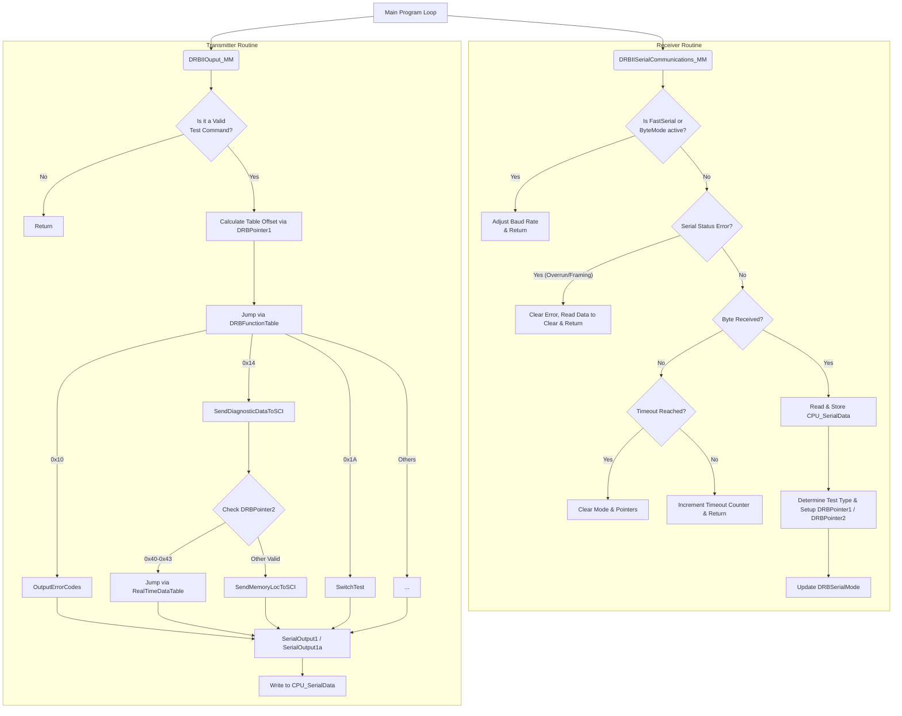

# SCI Port (Serial) Functionality Documentation
## 1. Overview
The Serial Communication Interface (SCI) port in the `T-SMEC_v19.asm` codebase is primarily used to handle communications with the DRB II diagnostic tool, aftermarket loggers, and test equipment. It relies on standard Motorola 68HC11 serial peripheral registers (`CPU_SerialStatus`, `CPU_SerialData`, `CPU_SerialBaudRate`, `CPU_SerialControl1`, `CPU_SerialControl2`). 

The logic for handling serial communication is divided into two main subroutines called from the main program loop:
- `DRBIISerialCommunications_MM`: Handles baud rate switching, receiving characters, error clearing, timeout checking, and command parsing.
- `DRBIIOuput_MM`: Evaluates the requested command/pointers configured by the reception routine and transmits the appropriate data response back to the client.

## 2. Serial Modes
The communication protocol supports three distinct operational modes, controlled by the `DRBSerialMode` flag variable:
- **Normal DRB Mode**: Standard diagnostic communication at a default baud rate. Responds to memory read requests, error code dumps, and DRB II tester routines.
- **Fast Serial (Hi-Speed Logger Mod)**: Speeds up the baud rate for aftermarket datalogging. In this mode, routine DRB decoding is bypassed to maximize polling frequency.
- **Byte Mode**: Used for special test operations, memory trim function setups, or code downloads (legacy S60 development feature).

## 3. Supported DRB II Functions
When a test command byte is received, it uses the `DRBFunctionTable` jump table to route execution. Below are the implemented commands:
- **0x10 (`OutputErrorCodes`)**: Reads and outputs stored error codes from memory.
- **0x11 (`OutputErrorBits`)**: Outputs real-time fault bit registers.
- **0x12 (`SetupHiSpeedDataTransfer`)**: Sets `bbe_FastSerial` bit and adjusts baud rate.
- **0x13 (`SetupATM`)**: Handles Actuator Test Mode (ATM) configurations.
- **0x14 (`SendDiagnosticDataToSCI`)**: A multi-purpose function for memory reads and real-time polling (MAP, RPM/Speed, O2).
- **0x16 (`SendECUIDToSCI`)**: Transmits the ECU Part Number Prefix and ID code.
- **0x17 (`ClearErrorCodes`)**: Erases diagnostic codes stored in RAM/EEPROM.
- **0x1A (`SwitchTest`)**: Transmits physical switch statuses.
- **0x1B (`InitByteModeDownload`)**: Enters byte-mode communication.

**Sub-Commands for Real-Time Data (`0x14` handler - RealTimeDataTable):**
- **0x40 (`SCI_MAPVolts`)**: Returns instantaneous A/D counts for MAP.
- **0x41 (`SCI_Speed`)**: Returns calculated vehicle speed.
- **0x42 (`SCI_O2Volts`)**: Returns raw/limited O2 sensor voltage data.
- **0x43 (`EndRealTimeData`)**: Exits real-time diagnostic polling mode.

## 4. Flowchart of Operations

## 5. Hi-Speed Logger Mod Protocol Instructions
This section details how to establish communications, enter the high-speed transfer mode, and repetitively poll data (MAP, O2, RPM, Coolant Temp).

### Phase 1: Open Communications & Enter High-Speed Mode
By default, the ECU listens at the standard DRB II baud rate.
1. **Send Test Command:** Send `0x12` (the `SetupHiSpeedDataTransfer` command).
2. **Change Client Baud Rate:** Once the `0x12` byte is received, the ECU immediately switches its internal baud rate to the `BAUDHI` rate and enters Fast Serial mode. You must now configure your client logger to match this high-speed baud rate. No padding bytes are required for this command.
3. **(Optional) Verify Mode:** Send `0xF2`. The ECU will immediately echo back `0xF2` to confirm it is successfully operating in high-speed mode.

### Phase 2: Polling Data (High-Speed Logger Mod)
Once in high-speed mode, the protocol becomes extremely simple. You simply send a single byte representing the RAM address you want to read, and the ECU will immediately transmit back the 1-byte value at that address.

To repetitively pull your requested parameters, loop the following sequence:

1. **Pull MAP:** 
   - Send `0x63` (RAM address for `MapValue`).
   - Read 1 byte response (MAP).
2. **Pull O2:** 
   - Send `0x6C` (RAM address for `RawAirFuelSensInput`).
   - Read 1 byte response (O2).
3. **Pull RPM:** 
   - Send `0x5D` (RAM address for `EngineRpm_HB` - High Byte).
   - Read 1 byte response.
   - Send `0x5E` (RAM address for `EngineRpm_LB` - Low Byte).
   - Read 1 byte response.
   - *(Combine HB and LB on your client to get the 16-bit RPM value).*
4. **Pull Coolant Temp:** 
   - Send `0x6A` (RAM address for `CoolantTemp`).
   - Read 1 byte response (Coolant).

*Note: You can send these addresses as fast as the baud rate allows. The ECU services this port on an interrupt/polling basis in its main loop and will rapidly blast the requested bytes back to you.*

### Phase 3: Exit High-Speed Mode
When you are done logging and wish to return the ECU to standard DRB-II operation:
- Send `0xFE`. 
- The ECU will immediately clear the high-speed flag and revert to the default DRB baud rate. You will need to drop your client baud rate back to standard to continue communicating.
